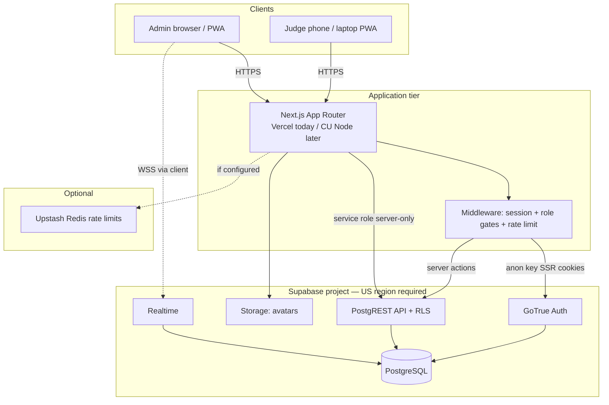
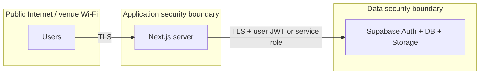
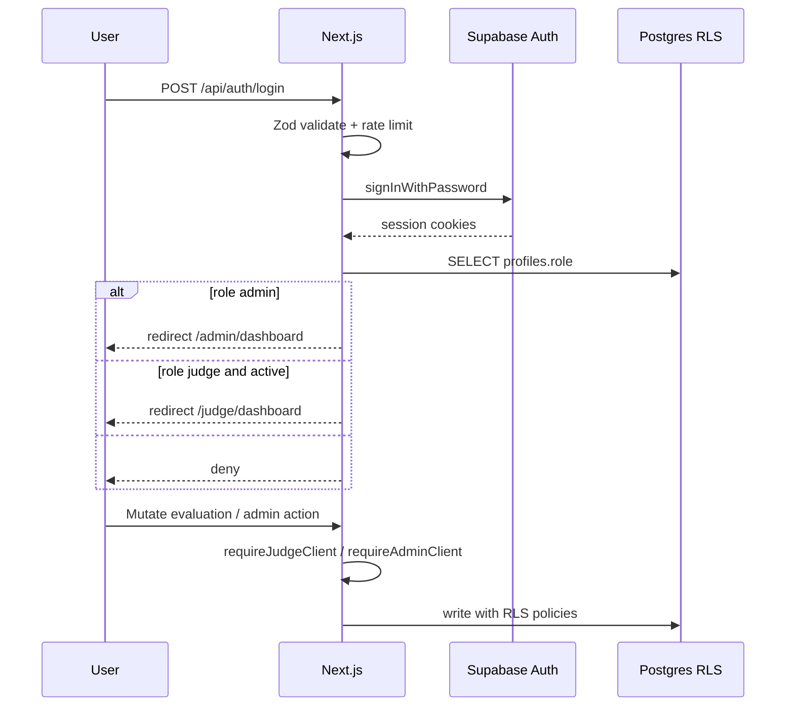

# §6a / §10 — Architecture and data-flow diagrams

## Logical architecture (current / Option A after app migration)

## Trust boundaries

## Authentication and authorization flow

## Data stores and sensitivity

| Store | Contents | Sensitivity |
|-------|----------|-------------|
| `auth.users` | Credentials (hashed) | High |
| `profiles` / `judges` | Identity | Moderate–High |
| `team_members` | Student names/emails | High (education PII) |
| `evaluations` / scores | Judging outcomes | Moderate–High |
| Storage `avatars` | Photos | Moderate |
| App logs | Auth events (no passwords) | Moderate |

## Components remaining external after proposed migration

| If Option A | External | University-managed |
|-------------|----------|--------------------|
| Web app | — | Next.js host |
| DB/Auth/Storage/Realtime | Supabase | — |
| DNS/TLS edge | — | CU reverse proxy |
| Source/CI | GitHub | — |

Update this table when OIT locks the option.
